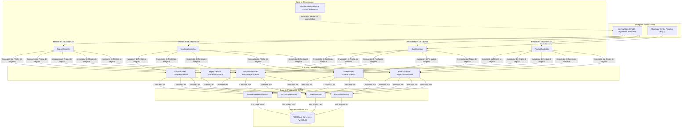
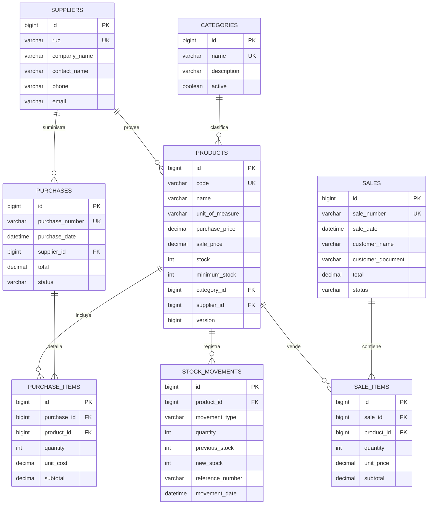

# INFORME TÉCNICO DE PROYECTO FINAL

# SISTEMA WEB DE GESTIÓN COMERCIAL, CONTROL DE INVENTARIOS Y FACTURACIÓN – "LIBRERÍA VICO"

---

## 📋 DATOS GENERALES DEL PROYECTO

* **Institución Académica:** Escuela Superior La Pontificia
* **Carrera Profesional:** Desarrollo de Software y Sistemas
* **Módulo / Especialidad:** Desarrollo Web Integrado & Programación Empresarial en Java
* **Nombre del Sistema:** Librería Vico – Inventory & Point of Sale Management System
* **Autor / Estudiante:** Teddy Camasca de la Cruz
* **Repositorio de Código Fuente:** [https://github.com/teddycam98/proyecto-examen](https://github.com/teddycam98/proyecto-examen)
* **Demostración en Vivo en la Nube (Producción):** [https://proyecto-examen.onrender.com/](https://proyecto-examen.onrender.com/)
* **Periodo Académico:** 2026

---

## 📝 RESUMEN EJECUTIVO (ABSTRACT)

El presente proyecto consiste en el diseño, desarrollo, validación y puesta en producción en la nube de un **Sistema Web Integral de Gestión Comercial y Control de Inventarios** para la microempresa comercial **"Librería Vico"**, dedicada a la comercialización de útiles escolares, artículos de oficina, arte y papelería general en el mercado peruano.

Tradicionalmente, las pequeñas y medianas librerías administran su stock, compras y ventas en registros físicos o plantillas aisladas de hojas de cálculo, generando descuadres en caja, quiebres de inventario no anticipados, lentitud al atender al cliente y pérdida de trazabilidad contable. Para mitigar esta problemática, se desarrolló una aplicación web con arquitectura cliente-servidor basada en **Java 21**, el framework empresarial **Spring Boot**, el motor de persistencia **Spring Data JPA / Hibernate**, una base de datos relacional en la nube **MySQL 8 (TiDB Cloud Serverless)**, plantillas reactivas renderizadas por servidor con **Thymeleaf y Bootstrap 5**, y un subsistema de generación de reportes ejecutivos en formato PDF utilizando **JasperReports 7**. 

El sistema se encuentra empaquetado bajo contenedores **Docker** y alojado de forma permanente 24/7 en la plataforma **Render PaaS** bajo protocolo seguro HTTPS, ofreciendo una solución accesible desde cualquier dispositivo, robusta, escalable y con cero costos de infraestructura.

---

## 1. DESCRIPCIÓN DEL PROYECTO Y PROBLEMÁTICA RESUELTA

### 1.1. Contexto de la Empresa
**Librería Vico** es un negocio del rubro minorista que comercializa más de 18 familias de productos de alta rotación (cuadernos Stanford, lápices y colores Faber-Castell, temperas y plastilinas Artesco, cartulinas Vinifan, etc.). Su dinamismo diario exige atención rápida en mostrador, cálculo inmediato de subtotales y una supervisión rigurosa de las existencias para coordinar pedidos con proveedores mayoristas.

### 1.2. Problemática Detectada (El "Antes")
Previo a la implementación del sistema, el negocio presentaba las siguientes deficiencias operativas:
1. **Quiebre de stock imprevisto:** Se ofrecían productos agotados al cliente porque no existía un sistema de alerta visual de stock mínimo.
2. **Ventas sin respaldo físico:** Ventas manuales realizadas a destiempo provocaban ventas duplicadas de unidades que ya no estaban en estantería.
3. **Descuadres en caja y pérdida de márgenes:** Confusión al calcular precios de costo frente a precios de venta, derivando en márgenes de ganancia distorsionados.
4. **Falta de Trazabilidad (Kardex ausente):** Se desconocía el motivo por el cual faltaba mercadería (mermas, robos hormiga, devoluciones o errores de digitación).
5. **Inexistencia de Reportes Ejecutivos:** La dirección del negocio no podía obtener un informe formal consolidado de su patrimonio en mercadería para auditoría o préstamos comerciales.

### 1.3. Objetivos del Sistema
* **Objetivo General:** Desarrollar e implementar un sistema web seguro, modular y transaccional que automatice el ciclo comercial (compras, ventas, inventarios y reportería) de Librería Vico.
* **Objetivos Específicos:**
  1. Garantizar consistencia transaccional mediante `@Transactional` y control de concurrencia optimista (`@Version`).
  2. Implementar un Punto de Venta (POS) reactivo que descuente el inventario al instante de confirmar la transacción.
  3. Establecer un registro inmutable de movimientos de almacén tipo Kardex (`stock_movements`).
  4. Generar reportes ejecutivos e imprimibles en formato PDF con JasperReports.
  5. Desplegar el sistema en un entorno cloud continuo con Docker y TiDB Cloud.

---

## 2. STACK TECNOLÓGICO Y JUSTIFICACIÓN TÉCNICA

A continuación se detalla la selección tecnológica adoptada en el proyecto, fundamentando el motivo de su elección en el ámbito del desarrollo de software moderno:

| Componente | Tecnología | Versión | Justificación Técnica |
| :--- | :--- | :--- | :--- |
| **Lenguaje Core** | **Java** | 21 (LTS) | Versión de soporte a largo plazo con compilación estricta, mejoras de recolección de basura (*Garbage Collection*), alta seguridad en tipado y excelente eficiencia de memoria. |
| **Framework Backend** | **Spring Boot** | 4.x / 3.x | Estándar de la industria para microservicios y aplicaciones web corporativas. Ofrece Inversión de Control (IoC), Inyección de Dependencias (DI) y configuración simplificada (*Convention over Configuration*). |
| **Capa de Persistencia** | **Spring Data JPA & Hibernate** | 7.x | Abstracción de acceso a datos mediante repositorios que reduce el código repetitivo (*boilerplate*) y mapea clases POJO directamente a tablas relacionales de base de datos. |
| **Base de Datos Cloud** | **TiDB Cloud (MySQL 8)** | Serverless | Motor relacional compatible con MySQL 8 de arquitectura distribuida nativa en la nube. Garantiza cumplimiento ACID, alta disponibilidad y escalabilidad automática sin costos fijos. |
| **Migración de Esquemas** | **Flyway** | 10.x | Herramienta de control de versiones de base de datos. Permite ejecutar migraciones SQL versionadas (`V1` a `V5`) garantizando que la estructura de tablas y datos semilla se reproduzcan de forma idéntica en cualquier servidor. |
| **Motor de Vistas** | **Thymeleaf** | 3.x | Motor de plantillas Java del lado del servidor (*Server-Side Rendering*) con sintaxis HTML5 limpia, sin etiquetas propietarias complejas y con soporte nativo para fragmentos reutilizables y expresiones de contexto. |
| **Framework de Estilos** | **Bootstrap & Icons** | 5.3 / 1.13 | Framework CSS adaptable (*Responsive Web Design*) que asegura compatibilidad fluida tanto en computadoras de escritorio de caja como en dispositivos móviles y tabletas. |
| **Generador de Reportes** | **JasperReports** | 7.0.6 | Motor líder para compilación, diseño y renderizado de documentos empresariales en PDF con tablas dinámicas, paginación automática y estilos tipográficos corporativos. |
| **Contenedores** | **Docker** | Multi-Stage | Empaqueta la aplicación aislando el entorno de compilación (Maven + JDK 21) del runtime (Alpine Linux liviano con fuentes tipográficas y librerías gráficas para JasperReports). |
| **Plataforma Cloud (PaaS)** | **Render.com** | Web Service | Proveedor en la nube que automatiza el despliegue continuo (*Continuous Deployment*) desde GitHub con certificado TLS/SSL emitido automáticamente. |
| **Gestor de Compilación** | **Apache Maven** | 3.9.x | Automatiza la resolución de dependencias, ejecución de pruebas unitarias y generación del ejecutable empaquetado. |

---

## 3. ARQUITECTURA DE SOFTWARE Y PATRONES DE DISEÑO

### 3.1. Arquitectura por Capas (Patrón MVC)
El proyecto fue construido siguiendo estrictamente la separación de responsabilidades:

### 3.2. Reglas Arquitectónicas Clave Aplicadas:
1. **Desacoplamiento Estricto:** Los controladores nunca interactúan directamente con los repositorios JPA; toda solicitud debe ser validada y procesada por la capa `Service`.
2. **Límites Transaccionales (`@Transactional`):** Cada operación que modifique stock o cree comprobantes se ejecuta bajo una transacción atómica. Si ocurre una anomalía (ej. caída de red o stock insuficiente a mitad del pedido), la transacción se revierte por completo (*Rollback*), evitando datos corruptos.
3. **Manejo Centralizado de Excepciones:** Se implementó `GlobalExceptionHandler` anotado con `@ControllerAdvice`, capturando `BusinessException` (errores controlados con retroalimentación en formularios) y `Exception` (errores imprevistos presentados con una interfaz amigable en lugar de una traza técnica insegura).
4. **Control de Concurrencia Optimista:** La entidad `Product` implementa un campo versionado con `@Version private long version;`. Si dos cajeros intentan modificar o vender el mismo producto en el mismo milisegundo, JPA detecta la colisión mediante el incremento de versión y evita inconsistencias en almacén.

---

## 4. MODELO DE DATOS RELACIONAL

La persistencia se modeló en tercera forma normal (3FN) con integridad referencial estricta y motores transaccionales InnoDB:

---

## 5. FUNCIONAMIENTO INTEGRAL Y MÓDULOS DEL SISTEMA

A continuación se describe el comportamiento de los módulos operativos que componen el sistema de Librería Vico:

### 5.1. Panel de Control (Dashboard Ejecutivo)
* **Ruta:** `/`
* **Función:** Consolida la situación del negocio en tiempo real:
  - Valor total del inventario valorizado a costo de compra (expresado en Soles S/).
  - Total facturado en el día y número de ventas realizadas.
  - Indicador numérico de artículos en estado crítico de reposición (stock $\le$ stock mínimo).
  - Acceso directo a operaciones rápidas y últimas transacciones.

### 5.2. Módulo de Catálogo de Productos
* **Ruta:** `/productos`
* **Función:** Centraliza la administración de artículos escolares y de oficina:
  - Búsqueda en tiempo real por nombre o código SKU.
  - Ficha de producto con control de margen comercial (el sistema valida que el precio de venta nunca sea menor al costo).
  - Asignación de categoría y proveedor oficial.
  - Carga segura de imágenes con servidor multimedia en `/media/productos/{filename}` y resolución con fallback a icono predeterminado.
  - Desactivación lógica de productos para preservar la integridad histórica de ventas pasadas.

### 5.3. Módulo de Punto de Venta (POS)
* **Ruta:** `/ventas/nueva`
* **Función:** Diseñado para la atención rápida y dinámica en mostrador:
  - Cuadrícula de artículos con filtrado instantáneo por categorías y selector de cantidad con botones táctiles `+` y `−`.
  - Carrito de compras interactivo desarrollado en JavaScript puro (`app.js`), que calcula subtotales, totales e impide agregar cantidades superiores a las existencias físicas reales.
  - Formulario de cliente con validación de documento (DNI de 8 dígitos o RUC de 11 dígitos).
  - Al hacer clic en **"Confirmar venta"**, se ejecuta el servicio transaccional: genera un comprobante secuencial único (ej. `V-20261022150856-760B`), descuenta el stock, registra la salida en el Kardex y redirige al detalle formal de la venta.

### 5.4. Módulo de Compras y Abastecimiento
* **Ruta:** `/compras/nueva`
* **Función:** Permite registrar los pedidos de mercadería que ingresan desde distribuidores o fábricas:
  - Selección de proveedor y número de guía/factura del distribuidor.
  - Registro de cantidades y costos unitarios de compra.
  - Actualización inmediata del stock en almacén e inserción de movimiento de tipo `COMPRA` en el Kardex.

### 5.5. Módulo de Movimientos y Kardex
* **Ruta:** `/inventario/movimientos`
* **Función:** Auditoría integral de cada unidad que entra o sale del almacén:
  - Registro de fecha y hora exacta, producto afectado, tipo de movimiento (`VENTA`, `COMPRA`, `AJUSTE_ENTRADA`, `AJUSTE_SALIDA`, `ANULACION_VENTA`).
  - Fotografía numérica: `Stock anterior`, `Cantidad variada` y `Stock resultante`.
  - Permite justificar mermas, artículos dañados o sobrantes físicos tras un inventario general.

### 5.6. Módulo de Reportes Oficiales en PDF (JasperReports)
* **Ruta:** `/reportes`
* **Función:** Emisión de reportes listos para imprimir o remitir a entidades financieras o contables:
  - **Reporte de Inventario Valorizado (`/reportes/inventario.pdf`):** Contiene el código, nombre, categoría, stock actual, costo unitario, valorización total acumulada y etiqueta de advertencia para productos en stock mínimo.
  - **Reporte de Ventas por Período (`/reportes/ventas.pdf`):** Permite filtrar por rango de fechas (con cálculo horario hasta las 23:59:59 del día final), discriminando comprobantes completados de ventas anuladas y sumando los ingresos netos.

---

## 6. MATRIZ DE PROBLEMAS RESUELTOS (ANTES vs. DESPUÉS)

| Aspecto Operativo | Antes (Proceso Manual / Cuaderno) | Después (Con Librería Vico Web) |
| :--- | :--- | :--- |
| **Control de Stock** | Conteo visual al momento de vender; frecuentes ventas de útiles agotados. | Descuento automático por cada venta. Bloqueo inmediato cuando la existencia llega a 0. |
| **Punto de Reposición** | La librería se quedaba sin cuadernos o cartulinas en plena temporada escolar. | Alertas automáticas en el Dashboard que listan los artículos con stock menor o igual al mínimo. |
| **Cálculo de Precios** | Cálculo mental o con calculadora básica, propenso a errores al cobrar al cliente. | Carrito automatizado que multiplica precio $\times$ cantidad y calcula el total exacto en Soles (S/). |
| **Trazabilidad de Pérdidas** | Pérdidas desconocidas por mermas o productos rotos no registradas. | Módulo de Kardex que audita cada movimiento con motivo, usuario y número de comprobante. |
| **Seguridad de la Información** | Cuadernos expuestos a deterioro físico, extravío o robo de registros. | Base de datos relacional en la nube (TiDB Cloud) con respaldos automáticos y cifrado SSL. |
| **Disponibilidad del Sistema** | Solo accesible si el encargado estaba presencialmente en el local. | Acceso 24/7 desde cualquier navegador o teléfono inteligente mediante enlace HTTPS. |

---

## 7. CONCLUSIONES Y RECOMENDACIONES

### 7.1. Conclusiones
1. **Éxito en el Despliegue Cloud:** Se logró poner en funcionamiento una solución empresarial completa (Spring Boot + MySQL) en internet a costo cero, aprovechando el poder de Docker, TiDB Cloud y Render PaaS.
2. **Robustez Transaccional:** La combinación de Spring Data JPA con control de concurrencia optimista (`@Version`) garantiza que nunca existan descuadres de inventario ni ventas concurrentes de stock inexistente.
3. **Calidad de Presentación:** La inclusión de JasperReports eleva la calidad técnica del producto, permitiendo transformar datos relacionales en reportes corporativos en PDF con diseño profesional.
4. **Cumplimiento de Objetivos Curriculares:** El proyecto integra con solidez los conocimientos de arquitectura MVC, persistencia relacional, programación orientada a objetos en Java, diseño web adaptativo y prácticas modernas de DevOps/Cloud.

### 7.2. Recomendaciones Futuras
1. **Emisión de Comprobantes Electrónicos (SUNAT):** Integrar un servicio web REST para firmar digitalmente XML de boletas y facturas electrónicas según el estándar UBL 2.1 de SUNAT.
2. **Lector de Código de Barras:** Incorporar compatibilidad de lectura USB / Bluetooth en la barra de búsqueda del POS para agilizar aún más la facturación en fechas de campaña escolar.
3. **Autenticación Basada en Roles (Spring Security):** Separar los permisos entre el perfil "Cajero" (solo ventas y consulta de precios) y el perfil "Administrador" (compras, ajustes de inventario y configuración de costos).

---

*Informe técnico elaborado y validado para sustentación académica.*  
**Autor:** Teddy Camasca de la Cruz – Desarrollador de Software
